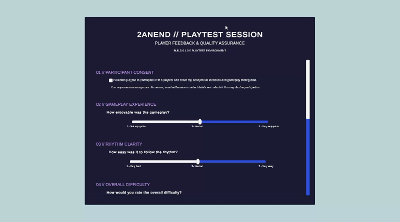

# QA & Telemetry Mini-Project
Zoe Efstathiou

2423029

For this project I split the work with a friend who handled the telemetry side.  

### Method
I created a reusable plugin for rhythm games in Unity. This plugin is a reusable user-testing survey with rhythm-game-specific questions. The survey is made using UI components in Unity, including sliders, buttons, toggles and player input boxes. Questions gather:
 - **Quantitative data:** slider from 1-5 asking players about their enjoyment, difficulty, audio and latency
 - **Qualitative Data** input boxes asking for additional feedback and bug reporting. 

The survey also features a consent tick box to ensure player's data is collected ethically. 

A local JSON backup is created for each successful local export. Survey responses are sent to the configured Google Apps Script endpoint using an HTTP POST request. The Apps Script receives the JSON data and appends it as a new row in Google Sheets. A successful local save and a successful remote upload are handled separately. If remote submission fails, the local JSON backup remains available.

To use the plugin, I have included a README.md file within the package folder to enable users easier use. Once imported into Unity using the Git repository URL, developers can easily drag the prefab into the scene. 

I also added a simple way for developers to easily apply their colour scheme to the plugin without having to enter code files. They can easily set their four colours in the PlayTestTheme component. These colours are then used within the UI of the survey. The four sections include:  Background Colour, Surface Colour,Primary Colour, Accent Colour.

### Improvements

Currently data is not erased after a certain amount of time from the Google Sheet. This could mean GDPR issues arise and so, it would be important to perhaps automate clearing of responses periodically. 

The Google Sheets method is not fully efficient and was done to save time but if I did this again I would chose another method. Google Sheets endpoint currently needs stronger validation and abuse protection before public deployment.

I would also add more customisation options such as custom font changes for developers to easily change like I did with colours. 

I also haven't yet connected my side of the projects with my parters telemetry side, although this would be simple to do as my partner's system automatically bundles any other exported JSON files to be sent to their Supabass Postgres table, so when we implement this fully into our FMP it will be compatible and simple. 